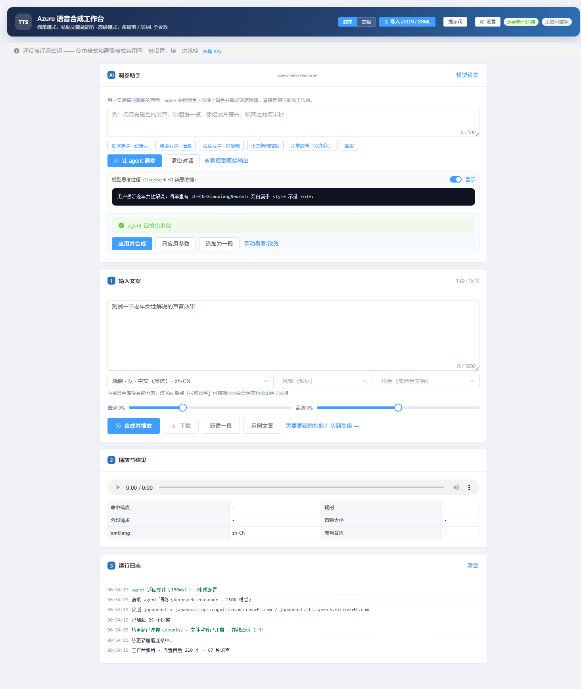

# tts-gen-webui · Azure 语音合成工作台

[](https://github.com/MoTeam-cn/tts-gen-webui/actions/workflows/check.yml)
[](LICENSE)


本地运行的 Azure 语音合成（TTS）工作台：**TypeScript 后端代理 + Element Plus 前端（unpkg CDN，无需构建、零依赖）**。

- **两种界面共用一套设置**：简单模式粘贴文案就能听，高级模式给多段落 / SSML / 全参数控制
- **全参数可视化**：`speak`、`voice`、`mstts:express-as`（style / role / styledegree）、`prosody`（rate / pitch / volume / contour）、`break`
- **AI 调参助手**：一句话描述想要的声音（“低沉磁性男声，像纪录片旁白”），模型输出参数直接套到工作台并合成；支持任意 OpenAI 兼容网关、可拉取模型列表、DeepSeek 类思维链实时显示
- **导入 AI 输出**：直接粘贴模型给的 JSON / SSML / markdown 代码块，自动归一化与纠偏
- **不会因为参数写错就哑火**：中文取值自动改写、音色前置校验、400 自动降级阶梯、一键诊断
- **events 热更新**：改 `public/` 或 `src/` 保存即刷新页面 / 提示重启



> 密钥只存在浏览器 localStorage，后端不落盘。请仅在你拥有授权的 Azure 语音资源上使用。

## 仓库

- 代码：<https://github.com/MoTeam-cn/tts-gen-webui>
- 问题反馈：<https://github.com/MoTeam-cn/tts-gen-webui/issues>
- 协议：[MIT](LICENSE)

## 启动命令

需要 Node.js ≥ 22.6（本项目用 Node 原生 TS 类型擦除运行 .ts，无需编译、无需 npm install）。

```bat
git clone https://github.com/MoTeam-cn/tts-gen-webui.git
cd tts-gen-webui
node src/server.ts
```

PowerShell 同样：`cd tts-gen-webui; node src/server.ts`。也可以双击 `start.bat`，或 `npm start` / `npm run dev`（watch 模式）。

- 默认地址 http://127.0.0.1:8899 ，换端口：`set PORT=8900` 后再启动。
- 零依赖：不需要 npm install，直接用 Node 24 的原生 TypeScript 支持（类型擦除）跑 `.ts`。
- 端口被占用时会打印中文提示，不会静默失败。

## 目录结构（前后端都已模块化）

```
tts-gen-webui/
├─ src/                       后端（TypeScript，node 直接运行）
│  ├─ server.ts               入口：路由 + 启动
│  ├─ config.ts               端口、MIME、格式表、上限常量
│  ├─ types.ts                共享类型
│  ├─ regions.ts              区域 → 域名映射（29 个区域）
│  ├─ http.ts                 JSON 响应 / 请求体 / http(s) 通用请求
│  ├─ ssml.ts                 SSML 组装、校验、文本切分
│  ├─ tts.ts                  合成：端点降级、令牌缓存、分段拼接
│  ├─ voices.ts               音色列表代理
│  ├─ events.ts               SSE 推送 + fs.watch 热更新
│  ├─ static.ts               静态文件
│  ├─ capabilities.ts         能力清单（给前端提示词与 agent 用）
│  ├─ importer.ts             导入解析（AI 输出 JSON/SSML 归一化）
│  └─ agent.ts                Agent 代理（模型列表 / 流式 chat 透传）
├─ public/
│  ├─ index.html              布局 + 8 个 x-template 模板
│  ├─ data.js                 内置音色库 210 个 + 语言/风格中文表
│  ├─ js/
│  │  ├─ main.js              应用入口（组装组件）
│  │  ├─ store.js             单一数据源：状态 + 全部动作
│  │  ├─ api.js               后端接口封装
│  │  ├─ ssml.js              前端 SSML 组装与校验
│  │  ├─ prompt.js            提示词生成（完整版 / 精简版）
│  │  ├─ agent.js             前端 agent：system prompt 拼装 / 流式解析 / JSON 抽取
│  │  ├─ constants.js         格式、角色、风格、默认值
│  │  └─ components/
│  │     ├─ cfg-panel.js      服务配置
│  │     ├─ params-panel.js   合成默认参数
│  │     ├─ script-panel.js   段落工作台
│  │     ├─ block-card.js     单个段落卡片
│  │     ├─ ssml-panel.js     SSML 预览 / 源码
│  │     ├─ result-panel.js   播放与结果
│  │     ├─ log-panel.js      运行日志
│  │     └─ prompt-dialog.js  提示词弹窗
│  ├─ favicon.svg
│  └─ preview.png
├─ package.json  tsconfig.json  start.bat  README.md
```

### 提示词怎么写的（防止模型跑去聊天）

模型容易犯的错：反问「你要哪一种」、给多个方案、说明“我无法生成音频”。现在的做法是把它当成**接口**而不是助手：

1. **角色定性**：开头就写「你是一个 TTS 参数生成器接口，不是聊天助手，整条回复必须是一个 JSON 对象本身」。
2. **绝对禁止清单**：禁止提问 / 反问 / 给方案选项 / 能力说明 / markdown 围栏 / JSON 前后加解释 / 向用户索要文案。
3. **3 个 few-shot 示例**（低沉男声、深夜电台女声、双角色对话），每个都是「输入：… / 输出：{JSON}」，把输出形状钉死。
4. **user 消息再包一层**：`【声音描述】… 【当前段落文本】… 【输出】立刻返回 JSON… 【要求】不要提问`，避免某些网关丢掉 system 消息后模型放飞。
5. **强制 JSON 模式**：默认给网关带 `response_format: {"type":"json_object"}`；若网关不支持（400 提到 response_format）后端自动去掉该字段重试一次。
6. **自动纠正重试**：模型仍然输出散文/反问时，前端把它的回复作为 assistant 消息附上，再追加一条「你上一条不是合法 JSON，只输出 JSON」的指令重试一次；还失败就保留原文，给「强制重试」「手动贴 JSON」两个出口。
7. **温度默认 0.2**（越高越爱自由发挥），面板上可调。
8. **取值必须机器可读**：prompt 里明写「voice 必须是 zh-CN-XiaoxiaoNeural 这种短名，禁止写『磁性男声』；style 必须是英文枚举，禁止写『纪录片旁白』；role 不许写『旁白』」。并给了**反例**与**正确改写**、以及「常见需求 → 音色短名」对照表（低沉男声→YunxiNeural、老年女性→XiaoxiangNeural、儿童→XiaoshuangNeural…）。

### 模型还是会写中文怎么办（两层纠偏）

| 层 | 位置 | 行为 |
| --- | --- | --- |
| 前端纠偏 | `public/js/agent-repair.js` `repairBlocks()` | 音色：短名直接过，中文走别名表 / 音色中文名 / 性别年龄兜底；**文案里明确写了「老年女性」而音色性别不匹配时以文案为准**。风格：34 个英文值直接过，否则按中文标签与关键词映射（纪录片旁白→documentary-narration、温柔→gentle、新闻→newscast…）。角色：8 个英文值直接过，「旁白/解说/叙述」判定为非 role 取值并移除（旁白交给 style），其余中文按关键词映射（女孩→Girl、老年男→SeniorMale）。改完在面板上列出「模型有 N 处取值不规范，已自动纠正」，日志里逐条记录 |
| 后端兜底 | `src/config.ts` `mapVoiceLoose` / `mapStyleLoose` / `mapRoleLoose` | 直接打 `/api/tts` 或走 SSML 预览时同样吃到这套映射，改写的每一项都会进 `x-tts-warnings`；非法值不再 400 |

### DeepSeek 类模型的思维链

流式代理会同时转发 `delta.reasoning_content`（也兼容 `delta.reasoning`），前端发 `reasoning` 事件 → 面板「模型思考过程」实时显示，可开关（`state.agent.showReasoning`）；非流式接口的返回体也带 `reasoning` 字段。`done` 事件里附 `hasReasoning` 便于排查。

## AI 调参助手（agent）

用一句话描述想要的声音，agent 帮你挑音色、定风格/角色、调语速音调，然后一键套到工作台并合成。

### 模型配置（设置 → Agent 模型）

| 字段 | 说明 |
| --- | --- |
| 模型地址 | 任意 **OpenAI 兼容**网关，填到 `/v1` 为止（如 `https://api.openai.com/v1`、one-api / new-api / LiteLLM / Azure OpenAI 代理）；没写 `/v1` 会自动补 |
| 模型 Key | 该网关的密钥（只存本机 localStorage，键 `ms_tts_agent_v1`） |
| 模型 | 点「拉取」调 `{地址}/models` 拿列表后下拉选择，也可以手输模型名 |
| 温度 | 0~2，默认 0.4（调参这种结构化任务建议低一些） |
| 应用后自动合成 | 默认开 |

浏览器直连模型地址常被 CORS 拦住，所以走本机后端代理：`POST /api/agent/models`、`POST /api/agent/chat`（后者把上游 SSE 转成本项目的 `delta` / `done` / `error` 事件流，前端边生成边显示）。

### agent 怎么知道该填什么

请求时自动拼一段 system prompt，内容包括：

1. 输出契约：必须是 `{"reply": "...", "blocks": [ ... ]}` 的 JSON，不带 markdown 围栏；
2. 官方硬规则：style 必填、role 只有 8 个取值、rate/pitch/volume/pauseAfter 的取值范围；
3. **音色清单**（前 80 个，含每个音色支持的 StyleList / RolePlayList）；
4. 当前工作台状态（区域、语言、格式、已有段落及其参数）；
5. 口语 → 参数的经验映射（低沉=男声+pitch -8~-15，治愈=gentle+慢速，新闻=newscast…）。

模型返回后前端用 `extractJsonCandidate` 抠 JSON，再走 `POST /api/import` 统一归一化与校验（字段别名、单位、超范围夹紧），最后套到工作台。解析失败时保留原始输出，可点「手动看看/改改」把文本丢进导入弹窗。

### 面板上的四个动作

- **应用并合成**：覆盖工作台参数 + 立刻合成播放
- **只应用参数**：只改参数，不动音频
- **追加为一段**：把 agent 给的配置追加成新段落（做多角色对话时用）
- **手动看看/改改**：把模型原始 JSON 填进导入弹窗，逐项确认

预置了 6 个描述模板（低沉男声·纪录片 / 温柔女声·治愈 / 活泼女声·短视频 / 正式新闻播报 / 儿童故事·双角色 / 客服），点一下就能改。

### 音色不存在 / Azure 400 怎么排查

400 的真实原因通常是**音色在你选的区域不存在**（例如之前提示词里我写错的 `zh-CN-XiaoxiangNeural` 根本不存在）。现在有三道防线：

1. **合成前就用 voices/list 校验音色**（结果缓存 10 分钟）：音色不在当前密钥+区域的列表里 → 直接 400，并给出**最接近的可用音色**（按编辑距离 + 同语言前缀排序），例如：
   `第 1 段的音色 zh-CN-XiaoxiangNeural 在区域 japaneast 不可用（不在 voices/list 里）。最接近的可用音色：zh-CN-XiaoxiaoNeural / zh-CN-XiaohanNeural / zh-CN-XiaoshuangNeural / zh-CN-XiaoyiNeural`
2. **Azure 原始报错翻成中文**：401/403、404、429、`Unsupported voice`、`Invalid SSML`、`output format` 各自有对应解释，附加在「逐条尝试记录」每一行后面，并以第一条可解释的原因为准（不再被后面端点产生的 401 带跑偏）。
3. **界面上的失败诊断**：播放与结果卡里直接显示错误摘要 + 原因 + 可展开的「逐条尝试记录」（含 Azure 原始 JSON，最多 800 字符）。

音色选择的正解：先在设置里填 Key，点「拉取音色」，下拉里出现的才是当前区域真实可用的音色；提示词里的音色清单也来自同一份列表。

### 400 且响应体为空怎么办（网关层拒绝）

Azure 有时只回一个 **400 + 空响应体**，一个字都不给。现在针对这种情况做了四件事：

1. **显式 Content-Length**：以前用 chunked 传 SSML，Azure 前置网关会直接 400 空体。现在所有请求都带 `content-length`（`src/http.ts`，普通请求与流式请求都改了）。
2. **输出格式白名单**：`format` 不在 `AUDIO_TYPE` 里（比如被改成了 `whatever-mp3`）会立刻 400 并列出可用格式，不再发给 Azure 撞空体 400。
3. **自动降级阶梯**（只对参数模式、且主端点返回 400 时触发）：
   完整参数 → 去 role → 去 role+style（保留语速/音调/音量）→ 只留音色与文本。
   任一级成功就出声，并在 warnings 里写明「已自动降级为 X」；全部失败才报错，并在提示里说明「问题不在 style/role，而在音色、输出格式或密钥所属资源」。
4. **一键诊断**（设置 → 一键诊断，或 `POST /api/diagnose`）：按 ①音色列表 ②最小 SSML ③带 style=general+prosody ④当前输出格式 逐项探测，直接告诉你哪一步 400。

逐条尝试记录里现在还会带上：`format=…`、Azure 的 `x-ms-request-id`、以及**实际发出的 SSML 前 300 字符**——排查时把这段贴出来就能定位。

## 微软官方端点与参数（2026-11 联网核对）

来源：
- REST 语音合成参考：https://learn.microsoft.com/zh-cn/azure/ai-services/speech-service/rest-text-to-speech
- SSML 语音与声音（style / role）：https://learn.microsoft.com/zh-cn/azure/ai-services/speech-service/speech-synthesis-markup-voice

### 端点

| 用途 | 地址 | 说明 |
| --- | --- | --- |
| 合成（推荐） | `https://{region}.tts.speech.microsoft.com/cognitiveservices/v1` | 官方 REST 文档的语音合成端点，文档列出了 33 个区域（含 japaneast） |
| 取访问令牌 | `https://{region}.api.cognitive.microsoft.com/sts/v1.0/issueToken` | 没有自定义子域时用区域端点 |
| 取访问令牌（有自定义子域） | `https://{resource}.cognitiveservices.azure.com/sts/v1.0/issueToken` | 资源配置了自定义子域时用 |
| 音色列表 | `https://{region}.tts.speech.microsoft.com/cognitiveservices/voices/list` | 返回里有 `StyleList` 与 `RolePlayList`，是判断能力的唯一权威来源 |
| ~~`https://{region}.api.cognitive.microsoft.com/cognitiveservices/v1`~~ | 实测 404 `Resource not found` | 旧路径，仅作兜底，不要单独依赖 |

### role（角色扮演）—— 只有 8 个官方取值

`Girl`、`Boy`、`YoungAdultFemale`、`YoungAdultMale`、`OlderAdultFemale`、`OlderAdultMale`、`SeniorFemale`、`SeniorMale`

- **不是 role 取值**（之前版本里我写错过的）：`Narrator`、`SportsCommentator`、`Reporter`。旁白请用 `style="narration-professional"` / `newscast`。
- `role` 必须放在 `<mstts:express-as>` 里，而 **`style` 是 `mstts:express-as` 的必填属性**：只给 role 不给 style 时，Azure 会忽略整个元素（官方文档原文：如果样式值缺失或无效，则忽略整个 mstts:express-as 元素）。所以工具在 role 无 style 时会自动补 `style="general"`。
- 是否真的生效取决于音色：voices/list 中该音色的 `RolePlayList` 必须包含这个角色；列表为空表示该音色不支持角色扮演。

### style（说话风格）—— 官方 34 个

`advertisement_upbeat, affectionate, angry, assistant, calm, chat, cheerful, customerservice, depressed, disgruntled, documentary-narration, embarrassed, empathetic, envious, excited, fearful, friendly, gentle, hopeful, lyrical, narration-professional, narration-relaxed, newscast, newscast-casual, newscast-formal, poetry-reading, sad, serious, shouting, sports_commentary, sports_commentary_excited, terrified, unfriendly, whispering`

- 具体某个音色支持哪些，看 voices/list 的 `StyleList`。
- `styledegree` 取 0.01 ~ 2（默认 1）；不支持时会被忽略。

### 我做了什么（针对「role 不支持」）

1. **前端 role 选项改成官方 8 个**（去掉 Narrator / SportsCommentator / Reporter），并标注“需音色支持”。
2. **参数预校验**（`src/tts.ts` + `src/voiceCache.ts`）：
   - role 不在 8 个取值内 → 直接 400，并告诉你官方取值和“旁白请用 style”。
   - 拉到 voices/list 时还会核对 `RolePlayList`：音色不支持角色 / 不支持某个角色 → 400 并列出该音色支持的角色。
   - 风格不被音色支持 → 不报错，**忽略该风格并在日志里提示**（附该音色可用风格列表）。
   - `sports-commentary` 这类笔误 → 自动纠正为官方 `sports_commentary`。
3. **前端选项按音色动态过滤**：拉到微软全量音色后，角色/风格下拉只显示该音色支持的项，并显示“该音色支持角色：…”提示。
4. **后端提示回传前端**：合成响应头 `x-tts-warnings`，前端把每条提示写进运行日志。
5. `/api/capabilities` 里补了 `styles`（34 个）、`endpoints_official`、`ssml_rules`、`docs` 字段，agent 可以直接读。

## 设置只有一份（简单 / 高级共用）

- 两种模式读写的都是同一份状态（`store.js` 里的 `state.cfg` 单例），填一次两边都生效：在简单模式抽屉里填 Key，切到高级模式摘要卡立刻显示已填（打码显示），反之亦然。
- 入口统一：右上角「设置」抽屉，内含**全部**设置——Key、区域、域名、自定义域名、输出格式、语言、默认音色/风格/角色/强度/音调/音量/停顿、测试连接、拉取音色、热更新按钮。
- 高级模式左栏不再重复一整套表单，改为「当前配置」摘要卡（密钥打码、区域、域名、格式 + 修改/测试/拉取按钮），避免两处长得不一样造成误解。
- 简单模式没填 Key 时，顶部提示条带「去填 Key」按钮，一键打开同一个抽屉。

### 老版本设置自动继承

v1 版用 `ms_tts_cfg_v1` 存配置，v2 用 `ms_tts_cfg_v2`。首次打开 v2 会自动从 v1 继承 Key / 区域 / 自定义域名 / 输出格式 / 默认音色 / 风格 / 语速 / 音调，并在日志里写一条「已从旧版本（v1）继承上次的密钥 / 区域 / 格式设置」。所以升级后 Key 不会“凭空消失”。

（如果你之前在**另一个端口/另一个浏览器标签**里跑的是旧版页面，那两边的 localStorage 键本来就不同；现在两个页面都指向同一套 v2 键，但旧标签里的旧版页面仍读 v1，属于预期行为，直接开新版页面即可。）

## 两种界面模式（默认就是简单模式）

- **简单模式（默认）**：一屏搞定——大文本框 + 音色 / 风格 / 角色三个下拉 + 语速、音调两个滑块 + 「合成并播放」「下载」。
  服务配置（Key、区域、域名、热更新按钮）收进右上角「设置」抽屉，不再挤在首屏。
- **高级模式**：多段落工作台（每段独立参数、增删排序复制）、SSML 参数/源码双模式、合成参数默认值批量套用、结果与日志分开看。
- 右上角「简单 / 高级」随时切换；导入多段内容或 SSML 时会自动切到高级模式，不会让人找不到东西。

## 导入 AI 输出（重点）

右上角「导入 JSON / SSML」→ 粘贴 → 「解析预览」→ 选覆盖或追加 → 「应用到工作台」。

能直接吃下的输入：

| 输入形态 | 处理 |
| --- | --- |
| 带 \`\`\`json 围栏 | 自动剥掉围栏 |
| 前后带解释文字 | 自动从第一个 \`{\` / \`[\` / \`<speak\` 开始截取到配对结尾 |
| blocks 数组 | 直接变成多段 |
| 单个 \`{ "text": ... }\` 对象 | 变成 1 段 |
| \`{ "mode": "ssml", "ssml": "..." }\` | 切到 SSML 源码模式并填入 |
| 整段 \`<speak>…</speak>\` | 校验后切到 SSML 源码模式 |
| segments / sections / items / paragraphs / data 数组 | 都当段落数组 |
| 字段别名 | voiceName / 音色 / speed / 语速 / styledegree / 强度 / 停顿 / break / content / 文案 等自动映射 |
| 带单位的值 | "−8%"、"10%"、"400ms" 自动转数字 |
| 超范围值 | 自动夹紧（rate 500 → 100）并在结果里提示 |
| 未知字段 | 忽略并提示，不会整单失败 |

解析结果会先给一张预览表（文本 / 音色 / 风格 / 角色 / 语速音调），确认无误再应用；支持「从剪贴板粘贴」与「选择文件」（.json/.txt/.xml/.ssml）。

## 参数能力（对齐 Azure SSML）

每个段落可独立设置，最终生成的 SSML 与你在需求里给的结构一致：

```xml
<speak version="1.0" xmlns="http://www.w3.org/2001/10/synthesis" xmlns:mstts="https://www.w3.org/2001/mstts" xml:lang="zh-CN">
  <voice name="zh-CN-XiaomoNeural">
    <mstts:express-as style="calm" role="YoungAdultFemale" styledegree="1.2">
      <prosody rate="-8%" pitch="-12%" volume="-20%">文案放这里</prosody>
    </mstts:express-as>
  </voice>
  <break time="400ms"/>
</speak>
```

| 参数 | 位置 | 范围 / 取值 |
| --- | --- | --- |
| voice | `voice name` | 音色短名，内置 210 个 + 接口全量 |
| locale | `speak xml:lang` | 如 zh-CN，默认按音色前缀推断 |
| style | `mstts:express-as style` | 29 种中文风格 |
| role | `mstts:express-as role` | Girl / Boy / YoungAdultFemale / YoungAdultMale / OlderAdultFemale / OlderAdultMale / SeniorFemale / SeniorMale / Narrator / SportsCommentator / Reporter |
| styleDegree | `styledegree` | 0.01 ~ 2，默认 1 |
| rate | `prosody rate` | -50 ~ 100 % |
| pitch | `prosody pitch` | -50 ~ 50 % |
| volume | `prosody volume` | -50 ~ 50 % |
| contour | `prosody contour` | 如 (0%,+20Hz) (100%,+40Hz) |
| pauseAfter | `break time` | 0 ~ 10000 ms |

两种模式：

- **参数模式**：多段落可视化编辑，每段独立音色/风格/角色/强度/语速/音调/音量/停顿；后端逐段拼 SSML，长文本按句切段（900 字），逐段请求后拼接音频。
- **源码模式**：直接写任意 SSML（phoneme、backgroundaudio、多 voice、复杂 contour 都行），后端只做校验与透传，可用于任何高级玩法。

SSML 校验（前后端同规则）：`<speak>` 根节点、`xmlns` 与 `xmlns:mstts` 声明、标签闭合、60KB 上限。

## 提示词（给 agent）

顶栏「提示词（交给 agent）」按钮打开弹窗，内含两版可复制文本：

- **完整版**：字段表（含取值范围与对应 SSML 位置）、role 全量取值、style 常用值、SSML 模板、7 条硬性规则、参数模式 JSON 示例、当前面板状态（区域/语言/音色/段数）、以及"只输出 JSON 或 SSML"的输出要求。
- **精简版**：字段 + role + 骨架 + 规则，一屏贴完。

复制给任意 agent，它就能产出可以直接粘回本页的内容。也可直接 `GET /api/capabilities` 拿到机器可读的同款说明书。

## 接口

| 接口 | 说明 |
| --- | --- |
| `GET /api/health` | 探活（含订阅者数、监听状态、最近事件） |
| `GET /api/capabilities` | 能力清单：模式、参数表、roles、formats、上限、示例 |
| `GET /api/regions` | 29 个区域及映射域名 |
| `GET /api/resolve?region=japaneast` | 单区域映射结果 |
| `GET /api/voices?region=&domain=` | 音色列表代理（Key 放 `x-tts-key` 头） |
| `POST /api/ssml/preview` | 参数 → 拼好的 SSML（不需要 Key，前端预览用） |
| `POST /api/import` | 导入解析：body `{"raw":"<AI 原文>"}`，返回 `{ ok, mode, blocks, ssml, warnings, summary, error }` |
| `POST /api/diagnose` | 一键诊断：`{key,region,domain,format}` → `{ok,region,format,steps[]}`（音色列表 / 最小 SSML / style / 格式逐项探测） |
| `POST /api/agent/models` | 拉取模型列表：`{baseUrl,key}` → `{ok,models[]}`（GET 上游 `{base}/models`） |
| `POST /api/agent/chat` | 调模型：`{baseUrl,key,model,messages,stream,jsonMode}`；`stream:true` 时返回本项目 SSE（`reasoning` / `delta` / `done` / `error`） |
| `POST /api/tts` | 合成，返回音频流；响应头带 `x-tts-endpoint / x-tts-chunks / x-tts-ms / x-tts-lang / x-tts-voices` |
| `GET /api/events` | SSE：`hello` / `reload`（改 public/ 自动刷新页面，改 src/ 提示重启） |
| `GET /api/events/status` | 订阅者、监听状态、最近事件 |
| `POST /api/reload` | 手动推事件，`{"scope":"frontend"}` 或 `"backend"` |

请求体（`POST /api/tts`）：

```json
{
  "key": "Azure 密钥",
  "region": "japaneast",
  "domain": "可选，自定义域名（支持 http:// 便于本地 mock）",
  "format": "audio-24khz-48kbitrate-mono-mp3",
  "mode": "params",
  "locale": "zh-CN",
  "blocks": [
    { "text": "文案放这里", "voice": "zh-CN-XiaomoNeural", "style": "calm", "role": "YoungAdultFemale", "styleDegree": 1.2, "rate": -8, "pitch": -12, "volume": -20, "pauseAfter": 400 }
  ]
}
```

源码模式把 `mode` 换成 `"ssml"` 并给 `ssml` 字段即可（旧版 `text`+`voice` 单段写法仍兼容）。

## 热更新

- 改 `public/` 下任意文件（含 js/ 模块）→ SSE 推 `frontend` → 页面 0.9 秒后自动刷新，输入内容与段落都会从 localStorage 恢复。
- 改 `src/` 或 `package.json` → 推 `backend` → 顶部黄色告警条提示重启，不会自动刷新。
- 顶栏显示「热更新已连接/未连接」，可手动重连、也可用「触发刷新事件 / 触发重启提示」按钮现场验证。

## 常见问题

- **8899 被占用**：`taskkill /F /IM node.exe` 清掉旧进程，或 `set PORT=8900` 换端口。
- **401 / 403**：Key 无效、过期或与区域不匹配；确认该区域已创建「语音服务」资源。
- **404 Resource not found**：把 api.cognitive 主机当合成端点用了，改用自动派生的 tts.speech 端点（面板已自动处理）。
- **音色少**：不填 Key 时用内置 210 个；填 Key 点「拉取音色（全量）」可拿微软全量 500+。

## 验收记录（2026-11-13 第四轮）

- 后端 11 个 TS 模块：`node src/server.ts` 直接运行通过，/api/health、/api/capabilities、/api/regions、/api/resolve、/api/ssml/preview、/api/tts 全部验证；假 Key 打真端点返回中文端点名 + 微软原文报错。
- SSML 生成实测：`style="calm" role="YoungAdultFemale" styledegree="1.2"` + `prosody rate="-8%" pitch="-12%" volume="-20%"` + `break time="400ms"`，与需求中的模板一致。
- SSML 校验：缺 `</speak>`、缺命名空间、标签不匹配都会返回中文错误；正常 SSML 通过并透传。
- 前端 8 个模块 + 8 个组件模板：Playwright 打开控制台 0 报错，6 张卡片正常渲染；两段对话生成 2 段请求，源码模式 1 段；提示词弹窗 3476 字，包含字段表、role 清单、SSML 模板与 JSON 示例。
- 合成：mock 上游下参数模式 2 段 → 上游 2 次请求、60000 字节、`参与音色` 回显两个音色；源码模式 1 段 → 30000 字节。
- 热更新：改 `public/js/constants.js` 页面自动刷新且标记变量被清空；`scope=backend` 触发黄色告警条。

## 更新记录

逐轮改动与验收记录见 [docs/CHANGELOG.md](docs/CHANGELOG.md)。
